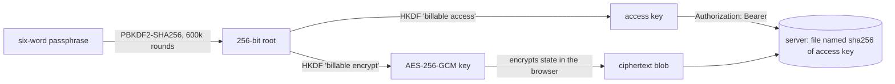

# Billable

A per-client hours tracker for a phone or a browser. Type a client name, press
Start and Stop through the day, and get a summary with each client rounded to the
nearest quarter hour, ready to email or paste into a work timesheet.

Live at [billable.chrislawrence.ca](https://billable.chrislawrence.ca). No account,
no build step, and no runtime dependencies.


## Categories and notes (optional)

Each client card has a **More** button that opens a category dropdown (P0 to P8,
Project Management, Gaps, Internal, Tech) and a note box. The running timer, and the
next one started on that card, are labelled with them.

- Changing the category or note mid-timer splits the time at that moment, so the time
  so far keeps the old label. Within the first minute it relabels the entry instead,
  so a quick correction leaves no near-empty fragment.
- The note box suggests every note used before under that category, across all
  clients, most recent first. Suggestions are derived from history rather than stored
  separately, so they build up and sync on their own.
- The summary, email and CSV list each client with one line per category and note.
  **Each line's time for the day is added up, then rounded once to the nearest 0.25 h**
  (7.5 minutes rounds up), because each line is entered separately at work. The client
  total is the sum of its lines. Rounding the total rather than each start/stop means
  three 8-minute stretches count as 24 minutes, so 0.5 h, rather than 0.75 h. A client tracked without
  categories reads exactly as before.
- Under Fix times, entries can be retagged when a switch was forgotten.
- A time typed under Fix times is saved when you leave the box, press Enter, or pause
  for two seconds, so a two-digit minute like 30 is never cut off after its first digit.

## Day-to-day helpers

- **Copy for Sheets**: each client in the summary has a copy button, because each
  client's hours go on its own tab of the work Google Sheet. It copies that client's
  lines as tab-separated rows, so one paste fills a row per line with each value in its
  own column. Notes gets only the note, never the category. A setting chooses Notes
  and Hours, or all five timesheet columns (Date, Employee, Costing
  section, Notes, Hours). A tick marks clients already copied, and clears if their time
  changes afterwards. Zero-hour lines are left out, and formula-like cells stay text.
- **Forgotten timers**: a timer still running from a previous day, or for four hours or
  more, raises a prompt to stop it at the time you actually finished, stop now, or keep
  going (which quiets it for two hours).
- **Timeline**: the day drawn as a bar of client-coloured blocks with untracked gaps
  hatched. Tapping a gap pre-fills a new entry for exactly that time; tapping a block
  jumps to that entry under Fix times.
- **Offline**: a service worker (`src/sw.js`) keeps the app itself on the device, so it
  opens with no signal. It never handles data or `/api/` requests, and each deploy
  installs a fresh copy.

## Privacy model

The default build makes one promise, and the browser enforces it: **after the page
loads, nothing leaves the browser.**

- **Data lives only in this browser's `localStorage`.** It is not encrypted on the
  device, so anyone using that browser profile can read it, like any site's saved data.
- **The page may open no connections.** The Content Security Policy is sent as a
  header, with a `<meta>` fallback:

  ```
  default-src 'self'; connect-src 'none'; img-src 'self' data:; font-src 'self';
  script-src 'self'; style-src 'self'; object-src 'none'; frame-ancestors 'none';
  form-action 'none'; base-uri 'none'
  ```

  `connect-src 'none'` blocks fetch, XHR, WebSockets, EventSource and beacons outright.
  Scripts, styles and images may come only from this site. There is no inline script,
  so no `'unsafe-inline'` and no hashes.
- **Everything the page needs loads with the page**, all self-hosted: the app modules,
  the vendored QR library, the stylesheet, the icons and the inline SVGs. Nothing is
  lazy-loaded, so nothing is fetched later.
- **No third parties.** No CDN, web fonts, analytics or error reporting.
  `Cache-Control: no-transform` stops Cloudflare injecting its bot-detection or
  analytics scripts into the HTML. Before that header was added, it did inject them.
- **The service worker** caches this site's own files for offline use and answers the
  page's requests from that cache. It handles only same-origin `GET`s, never `/api/`,
  never sees `localStorage`, and has no message, push or background-sync handlers.
  `sw.js` gets its own policy (`default-src 'none'; connect-src 'self'`), because a
  worker's fetches fall under `connect-src` and it must fetch the app's files to cache them.
  This is the one place anything is allowed to connect.
- **Data leaves only when you move it.** CSV and backup files are made in memory as
  `blob:` URLs and saved by the browser. Copy uses the clipboard. Email hands a
  `mailto:` link to the mail app. A transfer link carries its data in the `#` fragment,
  which is never sent to a server.
- **The server** stores no user data, and with sync off there is no API (`/api/` returns
  404). nginx keeps no access log. The reverse proxy deletes client addresses from its
  log. Cloudflare, which carries the traffic, sees what any CDN sees on page load.

### Verify it yourself

1. Open the app, then your browser's developer tools (F12), on the **Network** tab.
   Tick **Preserve log**.
2. Reload once and wait a few seconds for the page and its offline copy to finish
   loading. On a first visit the service worker caches the app's files; that's this
   site's own files only.
3. Press the 🚫 **Clear** button so the list is empty.
4. Use every feature:
   - add clients, start and stop timers
   - open **More** and set a category and note
   - edit and add entries under **Fix times**
   - tap timeline gaps and blocks
   - open **Summary**, change days, use each client's copy button and **Copy whole day
     as text**
   - **Move to another device**, then **Show transfer QR** and **Copy link**
   - under **Settings**: **Day as CSV**, **Export backup**, **Import backup** (pick the
     file you just exported), rename, remove and restore a client
5. **Expect the list to stay empty.** The only entries Chrome may show are `blob:`
   lines for the two downloads, which are files your browser made in memory, not
   network requests.
6. On the **Console** tab, expect no "Content Security Policy" messages. Any attempt to
   connect anywhere would be refused and reported there.
7. Optional: open **Application**, then **Service workers**, and tick **Offline**. Reload:
   the app still opens with your data.

The same check is automated in `tests/e2e/two-devices.mjs`. It records every request
the browser makes, page and service worker alike, while it uses every feature, and
fails on any network request or CSP violation.

## Optional: encrypted sync (off by default)

Built only with `ENABLE_SYNC=true ./deploy.sh`. With the flag off (the default):

- `sync-ui.js`, `sync.js`, `crypto.js` and `words.js` are deleted from the image, and
  their URLs return 404.
- The sync panel is removed from the HTML, and the API container does not run.
- `/api/` returns 404, and the CSP keeps `connect-src 'none'`.
- On load, any sync passphrase or keys left by an earlier sync-enabled build are
  deleted from the browser.

With the flag on, the CSP relaxes only to `connect-src 'self'` (its own sync endpoint),
and the privacy text switches to its sync version. The code below is kept, and tested
in both modes, so it can move to company infrastructure later.

### How it works



- **Passphrases.** Generated from the [EFF large wordlist](https://www.eff.org/dice):
  six words from 7,772, about 77 bits. A user may choose their own: at least 4 words
  and 20 characters. Case, spacing and punctuation are ignored.
- **Keys.** PBKDF2 produces a single 256-bit block, and HKDF expands it into two
  independent keys. Taking 512 bits straight from PBKDF2 would let someone holding the
  access key test guesses at half the cost, because PBKDF2 computes each output block
  separately.
- **Storage.** The server files each mailbox under `sha256(access key)`, so even a
  listing of its data directory does not reveal the keys needed to fetch from it.
  Writes carry the revision they were based on. A stale write gets `409`, and the
  client pulls, merges and retries.
- **Merging.** Every client, entry and the settings carry an `updated` timestamp, and
  deletions leave tombstones, so for each id the newest record wins. Two further rules
  depend only on the data, so every device reaches the same result:
  - If two devices each started a timer while apart, the earlier one stops where the
    later one began.
  - If both devices created a client with the same name, the clients merge into one.

## Layout

```
src/index.html, app.css     the page
src/js/config.js            build switches (SYNC_ENABLED), rewritten by the Dockerfile
src/js/model.js             state, time maths, rounding, merging      (pure)
src/js/bytes.js             base64url and compression                 (pure)
src/js/transfer.js          transfer-link encode, decode and import   (pure)
src/js/app.js               storage, rendering and event wiring
src/js/sync-ui.js           sync UI, loaded only by sync builds       ┐
src/js/sync.js              pull, merge, push; timeouts; 409 retry    │ removed from
src/js/crypto.js            key derivation, encryption                │ builds without
src/js/words.js             passphrase wordlist                       ┘ sync
src/sw.js                   offline cache of the app's own files
src/js/words.js             generated wordlist (tools/build-words.py checks its hash)
src/vendor/qrcode-2.0.4.js  qrcode-generator 2.0.4 (MIT), npm integrity verified
api/server.py               the sync mailbox: standard library only
tests/                      Node and Python unit tests, plus a browser end-to-end test
```

Everything except `app.js` runs under Node with no browser, which is what makes the
logic testable. Each module states its job in its opening comment.

## Running it

```sh
./deploy.sh                    # no sync: nginx only, no network requests after load
ENABLE_SYNC=true ./deploy.sh   # adds the sync API container and the sync UI
```

The compose file expects an external Docker network called `homelab-web` for the
reverse proxy in front. Change that for your own setup. The API sits on a private
network that only the front container joins. If you are not behind Cloudflare, set
`CLIENT_IP_HEADER=` (empty), so clients cannot choose their own rate-limit bucket.

## Tests

```sh
npm test                                            # unit tests, about two seconds
node tests/e2e/two-devices.mjs http://localhost:8175   # needs: npm i --no-save playwright
```

- **Unit tests** cover:
  - rounding, and time across midnight and both DST changes
  - merge convergence and commutativity
  - same-name collapse and concurrent timers
  - key derivation, tamper detection and fresh IVs
  - transfer-link round trips and decompression-bomb limits
  - CSV formula neutralising
  - the sync engine against an in-memory server, including a rival write mid-sync and
    a hung connection
  - the real HTTP server: revisions, size and mailbox caps, rate limits, and
    concurrent writers
- **The end-to-end test** drives isolated browser contexts through the real UI. On every
  build it checks categories, the timeline, forgotten timers, Copy for Sheets, offline
  loading, and network silence (zero requests after load, zero CSP violations, CSV and
  backup round trips). On sync builds it adds creating, joining, offline edits,
  deletion and QR linking. Both modes passed: 32 checks without sync, 39 with.

## Limits

The sync limits apply only to builds with `ENABLE_SYNC=true`.

| What | Limit |
|---|---|
| Synced blob | about 256 KB of ciphertext, which is years of entries |
| Mailboxes | 5,000 per server |
| New mailboxes | 10 per IP address per hour |
| Requests | 240 per IP address per 10 minutes |
| Idle mailboxes | deleted after 400 days |
| Tombstones | pruned after 180 days |
