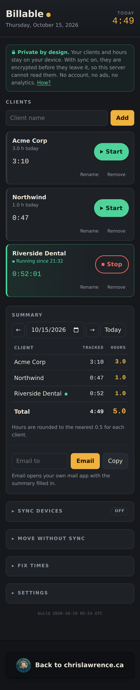
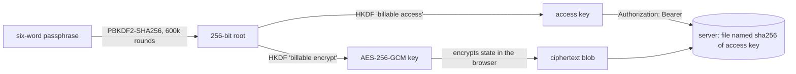

# Billable

A per-client hours tracker for a phone or a browser. Type a client name, press
Start and Stop through the day, and get a summary with each client rounded to the
nearest half hour, ready to email or paste into a work timesheet.

Live at [billable.chrislawrence.ca](https://billable.chrislawrence.ca). No account,
no build step, and no runtime dependencies.



## Privacy model

Billable is built so the server never holds anything readable about you.

- **Without sync**, data lives only in the browser's `localStorage`. Nothing you type
  is sent anywhere.
- **With sync**, data is encrypted in the browser before upload. The server stores
  an opaque blob it has no key for. The passphrase and the decryption key never
  leave the device.
- **Transfer links and QR codes** carry their payload after the `#`, which browsers
  never send to a server.
- **Email** is a `mailto:` link that opens the user's own mail client.
- **No IP addresses are recorded.** The sync server keeps them in memory, for at most
  an hour, for rate limiting only. nginx access logging is off, and the reverse proxy
  strips client addresses from its log.
- **No third-party code runs.** A strict Content Security Policy allows only same-origin
  scripts. That also blocks the analytics beacon Cloudflare injects.

### What it does not protect against

- **A server that serves altered JavaScript.** This is true of every web app that
  encrypts in the browser: you trust the code the server sends. This repository is
  public so that the code can be read.
- **Someone with the unlocked device.** Local data and the sync passphrase sit in
  `localStorage` unencrypted, like any web app's saved state.
- **Metadata.** The server sees when an encrypted copy is saved and how large it is.
  Cloudflare sees what any CDN sees: IP addresses, user agents and request times.
- **A lost passphrase.** It cannot be recovered or reset. Each device keeps its own
  full copy regardless.

## How sync works



- **Passphrases.** Generated from the [EFF large wordlist](https://www.eff.org/dice):
  six words from 7,772, about 77 bits. A user may choose their own: at least 4 words
  and 20 characters. Case, spacing and punctuation are ignored.
- **Keys.** PBKDF2 produces a single 256-bit block, and HKDF expands it into two
  independent keys. Taking 512 bits straight from PBKDF2 would let someone holding the
  access key test guesses at half the cost, because PBKDF2 computes each output block
  separately.
- **Storage.** The server files each mailbox under `sha256(access key)`, so even a
  listing of its data directory does not reveal the keys needed to fetch from it.
  Writes carry the revision they were based on. A stale write gets `409`, and the
  client pulls, merges and retries.
- **Merging.** Every client, entry and the settings carry an `updated` timestamp, and
  deletions leave tombstones, so for each id the newest record wins. Two further rules
  depend only on the data, so every device reaches the same result:
  - If two devices each started a timer while apart, the earlier one stops where the
    later one began.
  - If both devices created a client with the same name, the clients merge into one.

## Layout

```
src/index.html, app.css     the page
src/js/model.js             state, time maths, rounding, merging      (pure)
src/js/crypto.js            key derivation, encryption, encoding      (pure, Web Crypto)
src/js/transfer.js          transfer-link encode, decode and import   (pure)
src/js/sync.js              pull, merge, push; timeouts; retry on 409 (fetch is injected)
src/js/app.js               storage, rendering and event wiring
src/js/words.js             generated wordlist (tools/build-words.py checks its hash)
src/vendor/qrcode-2.0.4.js  qrcode-generator 2.0.4 (MIT), npm integrity verified
api/server.py               the sync mailbox: standard library only
tests/                      Node and Python unit tests, plus a browser end-to-end test
```

Everything except `app.js` runs under Node with no browser, which is what makes the
logic testable. Each module states its job in its opening comment.

## Running it

```sh
./deploy.sh                 # docker compose: nginx front plus the sync API
```

The compose file expects an external Docker network called `homelab-web` for the
reverse proxy in front. Change that for your own setup. The API sits on a private
network that only the front container joins. If you are not behind Cloudflare, set
`CLIENT_IP_HEADER=` (empty), so clients cannot choose their own rate-limit bucket.

## Tests

```sh
npm test                                            # unit tests, about two seconds
node tests/e2e/two-devices.mjs http://localhost:8175   # needs: npm i --no-save playwright
```

- **Unit tests** cover:
  - rounding, and time across midnight and both DST changes
  - merge convergence and commutativity
  - same-name collapse and concurrent timers
  - key derivation, tamper detection and fresh IVs
  - transfer-link round trips and decompression-bomb limits
  - CSV formula neutralising
  - the sync engine against an in-memory server, including a rival write mid-sync and
    a hung connection
  - the real HTTP server: revisions, size and mailbox caps, rate limits, and
    concurrent writers
- **The end-to-end test** drives five isolated browser contexts through the live UI:
  creating, joining, offline edits, deletion, QR linking and transfer links.

## Limits

| What | Limit |
|---|---|
| Synced blob | about 256 KB of ciphertext, which is years of entries |
| Mailboxes | 5,000 per server |
| New mailboxes | 10 per IP address per hour |
| Requests | 240 per IP address per 10 minutes |
| Idle mailboxes | deleted after 400 days |
| Tombstones | pruned after 180 days |
